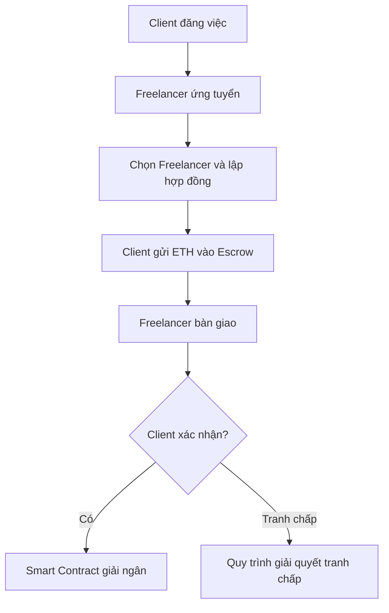

**Tài liệu:** *Building Ethereum Dapps: Decentralized Applications on the Ethereum Blockchain* — Roberto Infante, Manning (2019).  
**Đề tài:** Xây dựng nền tảng kết nối việc làm tự do ứng dụng Ethereum (Web3 Freelance Platform).  
**Sinh viên:** Nguyễn Thị Khánh Ly - 22070423
**Giảng viên hướng dẫn:** Hoàng Trọng Tiến
**Hình thức:** Báo cáo quá trình đọc sách và tìm hiểu công nghệ.


## 1. Chương 1 — A First Look at Decentralized Applications

### 1.1. Khái niệm và kiến trúc DApp

**DApp (Decentralized Application)** là ứng dụng sử dụng mạng phi tập trung và các quy tắc thực thi có thể được những nút mạng độc lập kiểm chứng. So với ứng dụng tập trung, DApp giảm sự phụ thuộc vào một nhà cung cấp duy nhất trong những chức năng được đưa lên Blockchain.

- **Centralized App:** Dữ liệu và quy tắc nghiệp vụ do một tổ chức vận hành và quản lý.
- **DApp:** Logic trọng yếu có thể thực thi thông qua **Smart Contract** và trạng thái được ghi nhận trên **Blockchain**.
- **Peer-to-Peer (P2P):** Các nút trao đổi giao dịch, khối và dữ liệu mà không cần một máy chủ điều khiển toàn mạng.
- **Consensus:** Cơ chế để những người tham gia thống nhất về trạng thái và khối hợp lệ.
- **Distributed khác Decentralized:** Hệ thống chạy trên nhiều server vẫn có thể tập trung nếu cùng một tổ chức kiểm soát tất cả server.

**Các thành phần trong mô hình sách:** Giao diện Web (HTML/JavaScript), thư viện Web3.js, Ethereum Node, Ethereum Virtual Machine (EVM), Smart Contract và Blockchain. Sách dùng DApp bỏ phiếu điện tử để minh họa.

### 1.1.3. Vòng đời giao dịch

1. Người dùng yêu cầu thao tác qua giao diện (ví dụ bỏ phiếu).
2. Giao diện tạo yêu cầu tương tác với Smart Contract; giao dịch thay đổi trạng thái được ký.
3. Giao dịch được gửi đến Ethereum Node và truyền qua mạng P2P.
4. Giao dịch được kiểm tra và xử lý theo quy tắc mạng, sau đó được đưa vào khối.
5. Các node xác minh kết quả; ứng dụng có thể đọc trạng thái hoặc theo dõi sự kiện (event) để cập nhật giao diện.

*Mô hình trong sách mô tả mining/Proof of Work (2019); Ethereum Mainnet đã chuyển sang Proof of Stake từ tháng 9/2022.*

### 1.1.4. Thuật ngữ

- **Smart Contract:** Chương trình thực thi những quy tắc và điều kiện được mã hóa trên Blockchain.
- **DO:** Decentralized Organization — tổ chức phi tập trung.
- **DAO:** Decentralized Autonomous Organization — tổ chức tự trị phi tập trung.
- **DAC:** Decentralized Autonomous Corporation — khái niệm tổ chức tự trị phi tập trung có tính chất công ty.

### 1.2. Good and Bad DApps

Blockchain phù hợp khi có nhiều bên cần chia sẻ và ghi nhận dữ liệu, thiếu niềm tin trực tiếp với nhau và cần kiểm chứng quy tắc giao dịch. Các trường hợp được sách nêu gồm xác minh nguồn gốc, danh tính, kiểm toán, bỏ phiếu và gây quỹ. Ngược lại, hệ thống nội bộ tập trung hoặc ứng dụng cần xử lý nhanh, riêng tư tuyệt đối thường không cần Blockchain. **Không nên dùng Blockchain nếu chi phí và độ phức tạp vượt lợi ích nghiệp vụ.**

### 1.3. Thực hành `SimpleCoin`

Tác giả xây dựng `SimpleCoin` trên Remix IDE để giới thiệu Solidity, `contract`, `mapping`, `constructor`, `msg.sender` và hàm `transfer`.

- Lúc khởi tạo, một địa chỉ ví thử nghiệm được cấp **10.000 SimpleCoin**.
- `coinBalance[address]` lưu số token của từng địa chỉ.
- Hàm `transfer(_to, _amount)` trừ token của người gửi và cộng cho người nhận.
- Ví dụ chuyển 150 token: số dư bên gửi từ 10.000 xuống 9.850; bên nhận từ 0 lên 150.

**Mã nguồn gốc đầy đủ của Listing 1.1:** [`code/chapter1/SimpleCoin_Original_2019.sol`](code/chapter1/SimpleCoin_Original_2019.sol).  
**Bản điều chỉnh để thực hành hiện đại:** [`code/chapter1/SimpleCoin_Modern.sol`](code/chapter1/SimpleCoin_Modern.sol).

> Ví dụ gốc cố ý đơn giản, không kiểm tra đủ số dư; với Solidity 0.4.x có nguy cơ tràn số khi chuyển quá số dư. Không dùng để quản lý tiền thật. Bản hiện đại thêm `require`, tự cấp token cho tài khoản deploy và phát `Transfer` event.

## 2. Chương 2 — Understanding the Blockchain

### 2.1. Cấu trúc Ethereum Node và việc triển khai DApp

Theo hình 2.1 của sách, một node gồm **Ethereum Client** và **Blockchain Database**. Ethereum Client có các thành phần chính:

| Thành phần | Vai trò |
|---|---|
| **EVM** | Thực thi bytecode của Smart Contract |
| **Mempool** | Lưu tạm giao dịch đang chờ xử lý |
| **Client Process** | Điều phối việc nhận, gửi và xác minh dữ liệu |
| **JSON-RPC API** | Cho phép phần mềm bên ngoài truy vấn, giao tiếp với node |
| **Blockchain Database** | Lưu khối, giao dịch, mã và trạng thái hợp đồng |

**Quy trình phát triển:** Viết Solidity → biên dịch thành EVM bytecode và ABI → deploy qua giao dịch → sử dụng Web3.js/giao diện Web để gọi hàm của Smart Contract. Chương này dùng hệ thống bỏ phiếu để giải thích quy trình; **không có Listing Smart Contract hoàn chỉnh mới**.

### 2.2. Công nghệ nền tảng

- **Public/Private Key:** Cặp khóa phục vụ xác thực và tạo chữ ký số. Private Key phải được bảo vệ, không gửi vào backend hoặc commit lên Git.
- **Digital Signature:** Giúp xác minh giao dịch do chủ thể có quyền ký tạo ra và nội dung được ký không bị thay đổi.
- **Cryptographic Hash:** Tạo giá trị tóm tắt có độ dài cố định; cùng dữ liệu có cùng hash, thay đổi nhỏ của dữ liệu làm hash thay đổi đáng kể.
- **Blockchain:** Các khối chứa giao dịch và liên kết với nhau thông qua hash khối trước, giúp phát hiện việc sửa lịch sử dữ liệu.
- **Proof of Work:** Cơ chế tạo khối bằng công việc tính toán, được sách dùng để mô tả Ethereum thời điểm 2019.
- **Proof of Stake:** Cơ chế đồng thuận dựa trên validator và tài sản đặt cọc; đây là cơ chế Ethereum Mainnet hiện tại.
- **Merkle Tree:** Cho phép tổng hợp dữ liệu bằng hash và xác minh một phần dữ liệu hiệu quả.
- **Merkle-Patricia Trie:** Cấu trúc Ethereum sử dụng để biểu diễn và kiểm chứng dữ liệu giao dịch, receipt và trạng thái.
- **EVM và Gas:** Smart Contract chạy trong môi trường thực thi của Ethereum; thao tác thay đổi trạng thái tiêu tốn gas.

### 2.3. Lịch sử và quản trị Ethereum

Ethereum được Vitalik Buterin đề xuất năm 2013 và đi vào hoạt động năm 2015. Sách đề cập sự kiện **The DAO (2016)** như một bài học về bảo mật Smart Contract và sự phân tách thành Ethereum và Ethereum Classic. Quá trình phát triển Ethereum có sự tham gia của cộng đồng và sử dụng cơ chế đề xuất cải tiến **EIP (Ethereum Improvement Proposal)**.


## 3. Liên hệ với đồ án Web3 Freelance Platform

Hệ thống dự kiến có hai vai trò chính: **Client** đăng việc và ký quỹ thanh toán; **Freelancer** ứng tuyển, làm việc và nhận tiền. Thay vì đưa toàn bộ website lên Blockchain, chỉ triển khai **Smart Contract Escrow** để quản lý khoản tiền ký quỹ và giải ngân có điều kiện.



- **Frontend/Backend/Database:** Quản lý hồ sơ, việc làm, đề xuất, thông báo, tài liệu.
- **MetaMask/Blockchain:** Ký giao dịch, kiểm tra chủ thể gọi và lưu trạng thái thanh toán.
- **Smart Contract:** Quản lý nạp ETH, quyền xác nhận, giải ngân, hoàn tiền và trạng thái hợp đồng.

**Kết quả sau hai chương:** Hiểu kiến trúc DApp, giao dịch Blockchain và thử nghiệm SimpleCoin. **Chưa hoàn thành Smart Contract Escrow hay toàn bộ hệ thống Freelancer**; đó là công việc của các giai đoạn tiếp theo.

## 4. Tài liệu tham khảo

1. Roberto Infante (2019), *Building Ethereum Dapps: Decentralized Applications on the Ethereum Blockchain*, Manning
2. [Ethereum Developer Documentation](https://ethereum.org/developers/docs/).
3. [Remix IDE](https://remix.ethereum.org/).
4. [Solidity Documentation](https://docs.soliditylang.org/).

---

**Trạng thái thực hành:** Báo cáo tóm tắt và mã minh họa đã chuẩn bị; kết quả chạy code và ảnh chụp kiểm thử cần bổ sung sau khi thực hành thực tế.


## PHỤ LỤC — SOURCE CODE ĐẦY ĐỦ

Các file bên dưới cũng có thể mở và chạy độc lập trong thư mục `code/`. **Chỉ file thứ nhất thuộc mã gốc Chương 1 của sách**; hai file còn lại là mã bổ sung cho việc thực hành, không được tác giả đưa ra trong Chương 2.

### A. Mã gốc Chương 1 — `SimpleCoin` (Listing 1.1)

```solidity
// Listing 1.1, Chapter 1, Building Ethereum Dapps — Roberto Infante (2019)
// Book sample code: Apache License 2.0 (as declared in the book).
// Legacy example: Solidity 0.4.x; educational use only.
// Insecure: lacks sufficient balance check and may underflow in 0.4.x.
pragma solidity ^0.4.0;

contract SimpleCoin {
    mapping (address => uint256) public coinBalance;

    constructor() public {
        coinBalance[0x14723A09ACff6D2A60DcdF7aA4AFf308FDDC160C] = 10000;
    }

    function transfer(address _to, uint256 _amount) public {
        coinBalance[msg.sender] -= _amount;
        coinBalance[_to] += _amount;
    }
}
```

### B. Bản thực hành Solidity hiện đại (bổ sung)

```solidity
// SPDX-License-Identifier: MIT
// Adapted educational example, not the original book listing.
// Compile with Solidity 0.8.20 or compatible 0.8.x compiler.
pragma solidity ^0.8.20;

contract SimpleCoinModern {
    mapping(address => uint256) public coinBalance;
    uint256 public totalSupply;

    event Transfer(address indexed from, address indexed to, uint256 amount);

    constructor() {
        totalSupply = 10_000;
        coinBalance[msg.sender] = totalSupply;
    }

    function transfer(address to, uint256 amount) external {
        require(to != address(0), "Invalid recipient");
        require(coinBalance[msg.sender] >= amount, "Insufficient balance");

        coinBalance[msg.sender] -= amount;
        coinBalance[to] += amount;
        emit Transfer(msg.sender, to, amount);
    }
}
```
